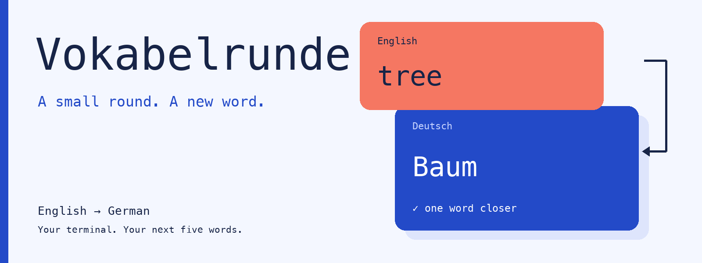
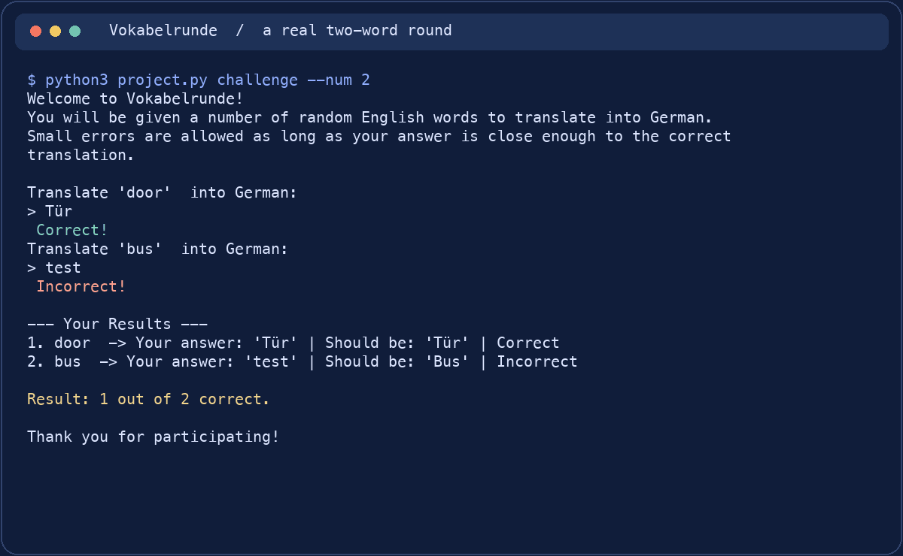

<p align="center">
  
</p>

<h1 align="center">Vokabelrunde</h1>

<p align="center">
  <strong>Five words. A little recall. One more round?</strong><br>
  English-to-German vocabulary practice in your terminal.
</p>

<p align="center">
  <a href="#take-a-round">Try it</a> ·
  <a href="https://www.youtube.com/watch?v=3rVBuE747-o">Original video</a> ·
  <a href="vocabulary.json">Word list</a> ·
  <a href="LICENSE">MIT License</a>
</p>

## Small rounds, familiar words

Start with an English word, type its German translation and get feedback straight away. Review the full list first, or jump into a random round. Vokabelrunde is a small, readable Python project for German learners and anyone learning to build a CLI.

| Review | Recall | Reflect |
| :--- | :--- | :--- |
| Browse **100 words** with emoji cues. | Pick your round length. Words are sampled without repetition. | Get instant feedback, then a recap of your answers and score. |

## A round in motion



*Captured from the running CLI with automated answers, then rendered as an animation. Emoji glyphs are omitted in this rendering.* [Still image](assets/terminal-demo.png) · [Full text transcript](assets/demo.txt)

## Take a round

**Python 3. No runtime packages, account or API key.**

```sh
git clone https://github.com/pengusto/vokabelrunde.git
cd vokabelrunde
python3 project.py challenge --num 5
```

Run from the repository directory so the program can find `vocabulary.json`. On Windows, use `py` instead of `python3` if that is your Python launcher. These commands were checked with Python 3.14.7.

| In the mood for… | Run |
| :--- | :--- |
| A look at the word list | `python3 project.py vocab` |
| The default 10-word round | `python3 project.py` |
| A longer, 15-word round | `python3 project.py challenge --num 15` |
| Command help | `python3 project.py --help` |

There is **no timer or saved progress**. Use a positive integer for `--num`; requesting more words than available uses the whole list. Ctrl+C leaves a round early without saving unfinished results.

## Close enough? Sometimes.

Answers are trimmed and checked case-insensitively against one stored translation. A character similarity score of **0.9 or higher** counts as correct.

This can forgive small differences, but it does not understand meaning. Short-word typos may still fail; synonyms, articles, plurals and alternative spellings are not automatically recognized. The word list shows the expected form.

<details>
<summary><strong>Add your own words</strong></summary>

Edit [vocabulary.json](vocabulary.json), keeping the existing JSON array and UTF-8 encoding. Each object needs `english` and `german`; `emoji` is optional:

```json
{"english": "friend", "german": "Freund", "emoji": "🤝"}
```

Restart the program after changes. The included 100 entries are a practice aid, not a comprehensive dictionary; suggestions for ambiguous translations are welcome.

</details>

<details>
<summary><strong>Explore the code and run the tests</strong></summary>

[project.py](project.py) contains the trainer: `argparse` handles commands, `random.sample` picks words and `difflib.SequenceMatcher` checks answers. All are part of Python's standard library.

The four existing [pytest tests](test_project.py) cover exact and incorrect answers, word selection and the results summary:

```sh
python3 -m venv .venv
.venv/bin/python -m pip install pytest
.venv/bin/python -m pytest test_project.py
```

On Windows, use `.venv\Scripts\python.exe` for the last two commands. `pytest` is the only external test dependency. The current `requirements.txt` also lists standard-library modules (`random`, `argparse`, `difflib`); installing that file is not required to run the trainer.

</details>

## Made for practice

A standalone terminal trainer by **Enis Uysal / [pengusto](https://github.com/pengusto)**. The [original project note](infos.md) dates the demo recording to March 2025. No maintenance schedule or release compatibility matrix is declared.

Found an unclear word or an unexpected result? [Open an issue](https://github.com/pengusto/vokabelrunde/issues) with your command, Python version and expected result.

Code, documentation, included vocabulary and the original README graphics are under the [MIT License](LICENSE), copyright © 2026 Enis Uysal. The linked video is outside this repository license. [Visual sources and rendering notes](assets/README.md).
